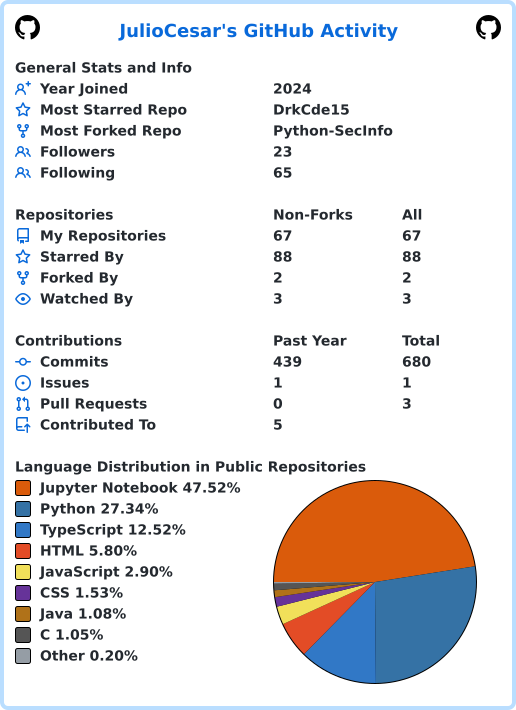

  

  <a href="#sobre">Sobre</a> &nbsp;·&nbsp;
  <a href="#projetos-em-destaque">Projetos</a> &nbsp;·&nbsp;
  <a href="#tecnologias">Tecnologias</a> &nbsp;·&nbsp;
  <a href="#conecte-se-comigo">Contato</a>

---

## Sobre

Sou Júlio César. Meus repositórios refletem meu interesse por **engenharia de dados**: exploro a construção de pipelines, processamento e qualidade de dados, bancos relacionais e orquestração. Também desenvolvo aplicações web e ferramentas para automatizar fluxos de trabalho.

## Projetos em destaque

| Projeto | O que você encontra |
|---|---|
| [**DataFlow**](https://github.com/DrkCde15/DataFlow) | Editor visual de workflows de dados, da ingestão à qualidade e ao armazenamento. **React · TypeScript · React Flow · FastAPI** |
| [**Pipeline-IBGE**](https://github.com/DrkCde15/Pipeline-IBGE) | Pipeline de dados públicos do IBGE SIDRA com transformação, validação e carga em banco. **Python · Airflow · PySpark · Pandera · PostgreSQL** |
| [**DAG-Manager**](https://github.com/DrkCde15/DAG-Manager) | Dashboard para monitorar e gerenciar DAGs em várias instâncias do Apache Airflow. **FastAPI · Streamlit · Docker/Podman** |
| [**DataWarehouse**](https://github.com/DrkCde15/DataWarehouse) | ETL de APIs públicas para um data warehouse PostgreSQL com esquema estrela e orquestração. **Python · Airflow · PostgreSQL · Podman** |
| [**NutriNow**](https://github.com/DrkCde15/NutriNow) | Aplicação web de acompanhamento nutricional e fitness com recursos de IA. **React · TypeScript · Flask · MySQL**. |

  <a href="https://github.com/DrkCde15?tab=repositories">Explorar todos os repositórios →</a>

## Tecnologias

### Dados e backend

  
  
  
  
  
  
  

### Web, bancos e ferramentas

  
  
  
  
  
  
  
  
  
  
  
  
  
  
  
  
  
  
  
  

## Conecte-se comigo

  
  
  

## Estatísticas do GitHub

  

  Obrigado pela visita! ✨

